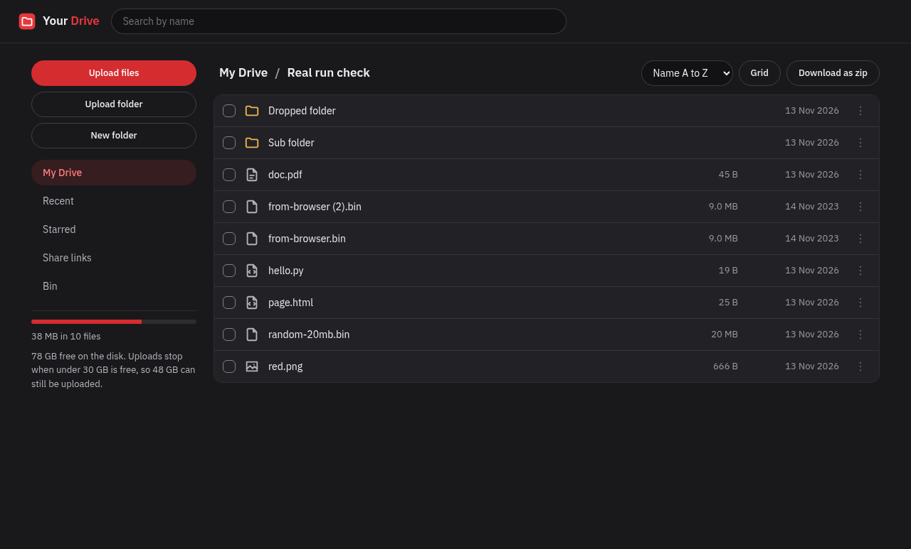

<div align="center">

# Drive

**Your own free take on Google Drive. Folders and files, big uploads that resume, previews, a bin, stars, recent files, folder zips and share links you control, all on your own disk.**

[](https://www.python.org/)
[](https://flask.palletsprojects.com/)
[](https://sqlite.org/)
[](LICENSE)

</div>



---

## Overview

Drive is a small self-hosted web app for your files. It has its own
sign-in for one owner account, so a copy runs on its own. It can also sit
behind a sign-in proxy: the author runs it behind the starfire sign-in like
the other apps, where Caddy checks the sign-in, then passes the request on.
Right now it runs on the laptop; the files for the later move to the server
are in `deploy/` (see [Moving it to the server](#moving-it-to-the-server)).

- **Folders and files**: new folder, rename, move, copy, delete to the bin.
  Select several items with the tick boxes, or drag items onto a folder or a
  folder name in the path at the top to move them.
- **Upload** with the buttons or by dropping files onto the page. Whole
  folders work too (the Upload folder button, or dropping a folder where the
  browser allows it), and the folders are rebuilt.
- **Large files** go up in 8 MB pieces with a progress bar. If the connection
  drops, the upload waits and carries on from the last piece the server has.
  If the page was closed, pick the same file again into the same folder and
  it carries on where it stopped (unfinished uploads are kept for 2 days).
  The page lists unfinished uploads left on the server, and each can be
  cancelled there to free its space. If the sign-in runs out mid-way, every
  upload stops with a message and carries on after signing in again.
- **Previews** for images, PDF (the browser's own viewer), text and code
  (shown as plain text, never run), audio and video (with seeking).
- **Download** a file, or a whole folder as a zip that is streamed while it is
  made (capped at 4 GB by default; a folder over the cap says so before
  anything downloads).
- **Bin**: restore, delete for good, empty; items are deleted for good after 30 days.
- **Starred**, **Recent** (newest added or opened), **search by name**,
  **sort** by name, date or size, **list or grid** view (grid shows small
  image thumbnails, made once and kept in `DATA_DIR/thumbs`).
- **Storage**: how much your files use, how much the disk has free, and how
  much can still be uploaded before the disk guard stops uploads.
- **Share links** (switched off by default, see below).
- **Convert** a file from its menu into a new file next to it (the original
  is never touched): pictures (including HEIC from phones) to JPEG, PNG, WebP
  or GIF; audio to MP3, M4A, Opus, Ogg, FLAC or WAV; video to MP4, WebM, a
  GIF or MP3; documents to PDF where LibreOffice can run safely. See
  [Converting files](#converting-files).
- **Cloud sync** keeps a Drive folder in step with a folder on Google Drive
  (one or more Google accounts), Nextcloud or any WebDAV server: both ways,
  upload only or download only, on demand or on a schedule. See
  [Cloud sync](#cloud-sync).
- Works on a phone: one column, big touch targets.

---

## Requirements

- Python 3.11+
- Flask, waitress, Pillow (grid thumbnails and picture conversions),
  pillow-heif (reads HEIC/HEIF; its wheels bring their own libheif) and
  cryptography (seals cloud passwords and sign-ins), pinned in
  `requirements.txt`
- For conversions: `prlimit` (util-linux) for every converter, `ffmpeg` and
  `ffprobe` for audio and video, and LibreOffice (`soffice`) plus a working
  `unshare --user --net` for documents. Whatever is missing is switched off
  and the start-up log says which.
- Tests also need wsgidav (a local WebDAV server), in `requirements-dev.txt`

---

## Run it on the laptop

```bash
cd drive
python3 -m venv .venv
.venv/bin/pip install -r requirements.txt
cp .env.example .env
.venv/bin/python -m drive
```

Then open `http://127.0.0.1:8102` and make the owner account (see below).
`AUTH_MODE=local` switches the sign-in off for a copy only you use on this
machine: it then refuses to listen on anything but `127.0.0.1`, `::1` or
`localhost`. A laptop copy can set `AUTH_MODE=local`, point `DATA_DIR` at
`~/.local/share/drive` and set `MIN_FREE_GB=30`, so uploads stop before the
laptop drops under 30 GB free. Stop it with Ctrl+C; there is no service.

---

## First run and sign-in

Drive has its own sign-in, switched on by default (`AUTH_MODE=builtin`).
There is one owner account and no sign-up page.

1. Start it (`.venv/bin/python -m drive`) and open
   `http://127.0.0.1:8102`. With no account yet every page goes to
   **Set up**.
2. The app writes a one-time setup code to its log when it starts, a line
   like `no owner account yet: open /setup and enter the setup code ...`.
   Enter that code, a user name and a password (10 characters or more,
   twice). The code stops anyone else who reaches the page first from
   making the account, and it works once: if the owner file is ever
   deleted, the next visit to **Set up** writes a new code to the log.
3. After that, every page goes to **Sign in** until you sign in. A session
   lasts 30 days. `/signout` signs out on every device.

How it is protected:

- The password is stored as an scrypt hash in `DATA_DIR/owner.json`
  (mode 600), never in plain text.
- 5 wrong passwords or setup codes from one address within 15 minutes lock
  that address out for the rest of the 15 minutes (`429`). Attempts sent
  at once are counted before they are checked, IPv6 addresses count by
  their `/64` network, and after 100 failures from everywhere within 15
  minutes each address gets one try and each network three (IPv4 by `/24`,
  IPv6 by `/48`). A right password from a locked address is refused too.
- During such an attack one wrong password from a neighbour on the same
  provider network does not keep your new browser out: that takes three
  wrong passwords within 15 minutes from three of their addresses (IPv4)
  or three of their home lines (IPv6, where a line's whole `/56` counts as
  one address).
- A browser that has signed in before keeps a signed device cookie and has
  its own 5 tries, so a stranger who locks out your address (or the
  address of the proxy in front) cannot lock you out of that browser.
  During an attack from many networks that browser is the way in.
  Making a new owner account ends every device cookie of the old one.
- The session cookie is `HttpOnly`, `SameSite=Lax` and signed with the app's
  secret key. It is `Secure` everywhere except plain `http` on `localhost`,
  `127.0.0.1` or `[::1]` (`SECURE_COOKIES=auto`). On a plain `http` address
  on your home network the browser drops a `Secure` cookie and the sign-in
  page says so: use https, or set `SECURE_COOKIES=false` there.
- Forget the password? Stop the app, delete `DATA_DIR/owner.json`, start it
  again and set up a new owner with the new setup code from the log. Your
  data stays.

Behind a reverse proxy for https, with the own sign-in still on: list the
proxy's address in `TRUSTED_PROXIES` so the lockout counts each visitor's
address from `X-Forwarded-For` instead of the proxy's (the header is read
only from those addresses), and put the public host name in
`ALLOWED_HOSTS`. By default the own sign-in answers only on `localhost`,
`127.0.0.1`, `[::1]`, IP addresses and this machine's own name; any other
`Host` gets `421`, so a web page cannot reach a copy on your machine by
DNS rebinding.

To run it behind a sign-in proxy instead, set `AUTH_MODE=proxy` and list the
proxy's address in `TRUSTED_PROXIES`. The user header is then believed only
from those addresses; in the default mode it is never read.

---

## Settings

All settings come from the environment or a `.env` file in the folder you
start it from.

| Setting | Default | What it does |
|---|---|---|
| `AUTH_MODE` | `builtin` | `builtin`: the app's own sign-in, one owner account. `proxy`: trust the user name a proxy puts in `USER_HEADER`, only from `TRUSTED_PROXIES`. `local`: no sign-in, loopback only. |
| `BIND_HOST`, `PORT` | `127.0.0.1`, `8102` | Where it listens. |
| `DATA_DIR` | `./data` | The database, the files, unfinished uploads, the owner account (`owner.json`) and the secret key. |
| `TRUSTED_PROXIES` | empty | With `AUTH_MODE=proxy`, the addresses allowed to set the user header; proxy mode refuses to start without it. Wide public ranges are refused. In `builtin` mode, the proxies whose `X-Forwarded-For` gives the visitor's address to the lockout. |
| `ALLOWED_HOSTS` | empty | In `builtin` mode, the only host names the app answers on, comma separated (others get 421). Empty: `localhost`, `127.0.0.1`, `[::1]`, IP addresses and this machine's own name. |
| `SECURE_COOKIES` | `auto` | With `AUTH_MODE=builtin`, the session cookie is `Secure` except on plain `http` to `localhost`, `127.0.0.1` or `[::1]`. `true` or `false` force it. |
| `USER_HEADER` | `X-Forwarded-User` | The header the proxy sets. |
| `ALLOWED_USERS` | empty (anyone the proxy names) | Comma list of user names allowed in. |
| `SECRET_KEY` | made on first start in `DATA_DIR/secret_key` | Signs CSRF tokens, the session cookie and share unlock cookies. At least 32 characters if set. |
| `SHARES_ENABLED` | `false` | Turns share links on. |
| `PUBLIC_SCHEME` | `https` with `AUTH_MODE=proxy`, `http` with `builtin` and `local` | The scheme people use in the browser. Writes must come with an `Origin` of this scheme and host, and share unlock cookies are `Secure` when it is `https`. Set `http` when testing proxy mode on plain `http://127.0.0.1`. |
| `PROXY_SECRET` | empty | With `AUTH_MODE=proxy`: when set (32+ characters), a request only counts as the owner if it also carries this value in `X-Drive-Proxy-Secret`, so only Caddy can act as the owner, not any other program on the proxy machine. `deploy.sh` makes one. |
| `MIN_FREE_GB` | `15` | Uploads are refused when the disk would drop under this much free space (GB here means GiB, as `df -h` shows it). |
| `MAX_FILE_GB` | `20` | Largest single file. |
| `ZIP_MAX_GB` | `4` | Largest folder zip. |
| `CONVERT_TIMEOUT_MINUTES` | `15` | A conversion still running after this is stopped and its partial file removed. |
| `CONVERT_MAX_INPUT_GB`, `CONVERT_MAX_OUTPUT_GB` | `4`, `4` | Largest file a conversion starts from, and largest result it may write. |
| `CONVERT_MEMORY_MB` | `3072` | Address-space cap (`prlimit --as`) for each converter process. ffmpeg needs far more address space than it uses: 4K encodes fail under 1.3 GB although they use about 600 MB. |
| `WORK_MEMORY_MB` | `1536` | Memory set aside for the heavy work: thumbnails, conversions and their tools all reserve their measured need from it before they start, so together they never use more. Work that could never fit is refused with the amount it needs. |
| `SYNC_BIN_LIMIT_FILES`, `SYNC_BIN_LIMIT_PERCENT` | `100`, `50` | The bin brake: a sync run that would move more than this many synced files to a bin, or more than this share of them (when that is more than 3 files), stops and waits for a yes on its card. |
| `GOOGLE_CLIENT_ID`, `GOOGLE_CLIENT_SECRET` | empty (Google sync off) | The OAuth client for Google Drive sync. Both or neither; see [Cloud sync](#cloud-sync). |
| `TOKEN_KEY_FILE` | made on first start in `DATA_DIR/token.key` | The key that seals saved app passwords and Google sign-ins. Losing it means signing in to every connection again. |

---

## How files are kept

`DATA_DIR` holds `drive.db` (SQLite: the folder tree, names, stars, the bin,
share links, unfinished uploads), `blobs/` (the file contents, each named by a
random id, so a file name never becomes a path on disk), `uploads/` (pieces
of unfinished uploads), `thumbs/` (grid thumbnails), `token.key` (seals
cloud sign-ins, mode 600) and `tmp/` (conversion and sync work folders,
cleared on start). The app
creates `DATA_DIR` as 700 and `drive.db` as 600. Copies are hard links, so
copying a file costs no extra space (the storage line counts them once);
the bytes go when the last copy is deleted for good. Item ids are never
handed out twice, so an upload can never land in a folder made after its own
folder was deleted (such an upload is dropped with a message instead).
Databases from before this rule are rebuilt once on start, keeping
everything.

To back it up, stop the app and copy `DATA_DIR`, or copy `blobs/` and use
`sqlite3 drive.db ".backup copy.db"` while it runs.

---

## Share links

Share links are **off** unless `SHARES_ENABLED=true`. While they are off,
every `/s/...` address answers 404 and the Share dialog says links are off.

When they are on, the Share dialog makes a link to one file or folder:

- The link is `https://<host>/s/<43 random characters>` (32 random bytes).
  Guessing one is not practical, and wrong, revoked or deleted links all
  answer the same 404.
- Optional expiry (1 hour to 30 days in the dialog; the API takes up to 10
  years). Expired links answer 410.
- Optional password (6 or more characters, stored as a salted scrypt hash).
  After the right password the browser gets a signed cookie for that link
  only, valid for 12 hours. After 10 wrong passwords in 15 minutes the link
  refuses passwords for the rest of that window.
- Read-only: people with the link can list, preview and download, and zip a
  folder. They cannot change anything, and they only reach the shared item
  and what is inside it. Moving a file out of a shared folder, binning it, or
  binning the shared item takes it out of the link at once.
- A link to something in the bin stays in the Share links view, marked as in
  the bin: it answers 404 while the item is binned and works again if the item
  is restored, so revoke it there if it should not come back. Deleting the
  item for good deletes its links.
- At most 8 shared downloads run at once (more get 503 and a "try again"
  message), so share links can never take every server thread. Any download,
  shared or not, that makes no progress for 2 minutes is closed.

The share page and its API live under `/s/` and are the only thing that
works without signing in. Behind starfire, only `/s/*` skips the sign-in
check in Caddy (`deploy/Caddyfile.drive`); everything else still needs it.
The app does not trust Caddy alone for this: requests under `/s/` never
count as the owner, and every other path still needs the owner's session
(or, in proxy mode, the user header from a trusted proxy).

## Converting files

Pick **Convert to...** in a file's menu. The dialog lists the formats that
fit that file; the result is saved next to the original under a free name
(`photo.jpg` becomes `photo.png`, or `photo (2).png` if that name is taken)
and the **Conversions** panel shows each job running, saved or failed with
the reason. Pictures convert from their first frame, turned the right way up;
JPEG gets a white background where the picture was see-through.

How it is kept safe:

- Every tool runs from a fixed argument list, never a shell, under `prlimit`
  (address space, CPU time and the size of any file it writes) in its own
  process group. The tool is started as a child subreaper, so processes it
  starts stay under it even when their parent exits. When
  `CONVERT_TIMEOUT_MINUTES` runs out every process under the tool is first
  stopped (`SIGSTOP`, so none can start another), including ones that
  started their own session: Drive reads the children list in `/proc` of
  every process it has found on every look, stopped or not (or, where the
  kernel has none, reads all of `/proc` and follows every new process number
  the kernel hands out meanwhile), stops each process the moment it finds
  it, and looks again until each process it found is seen stopped and
  nothing new turns up. Children that had already ended are
  read once and never signalled. The search gives up after 3 seconds, also
  in the middle of one long look, and then logs that not every process was
  seen stopped. Then everything it found is killed, with the tool's group
  last, also when reading `/proc` fails. A process that
  escapes after the tool has finished normally is not chased.
  Only the first 1 MB of what a tool prints and the last 2000 bytes of its
  errors are kept, and once the tool has exited Drive waits at most a second
  for anything still holding its output. Partial results are deleted and
  nothing is added to Drive unless the tool finished and the file is
  non-empty and below both its own limit and `CONVERT_MAX_OUTPUT_GB`, so a
  result that reached either is never kept as finished.
- At most two conversions run at once; a third gets `503` at once. Each job
  first sets aside the disk its largest result could need (video and
  lossless audio `CONVERT_MAX_OUTPUT_GB`, MP3, M4A, Opus and Ogg 32 times the
  file, pictures their raw pixel size, documents eight times the file; at
  least 64 MB and at most `CONVERT_MAX_OUTPUT_GB`) plus 16 MB, the tool may
  not write a bigger file (a result that needs more fails with "the result
  would be over N MB", N being that limit or `CONVERT_MAX_OUTPUT_GB` if it
  is lower; it is never cut short), and the job is refused when
  that would take the disk under `MIN_FREE_GB`. The limit is per file: a
  tool that writes several files of its own can use more than the promise
  while it runs, and the result is checked against the floor again before
  it is kept. Each also reserves its memory from `WORK_MEMORY_MB` first
  (pictures by their size and format, video by its frame size).
- Pictures are opened in a separate Python process and must be at most 100
  megapixels.
- ffprobe must name one of a fixed list of formats, ffmpeg is then forced
  to that format and may only read files, so a playlist cannot reach other
  files or the network.
- Documents (Word, Excel, PowerPoint, OpenDocument, RTF) become PDF only when
  the network can be cut off with `unshare`; LibreOffice gets a fresh profile
  per job with macros switched off. In Docker this is off, because the image
  has no LibreOffice and Docker does not allow `unshare`.

---

## Cloud sync

**Cloud sync** in the sidebar lists the connections. Each one links one Drive
folder with one cloud folder, in one direction:

- **Both ways**: new and changed files go across in both directions.
- **Upload only**: Drive is the source; the cloud folder is made to match it.
- **Download only**: the cloud is the source; the Drive folder is made to match.

A connection runs when you press **Sync now**, or every 15 minutes, hour,
6 hours or day. Each card shows when it last ran, what it did, the first
errors and any names it skipped. Two syncs run at most at once, and one
connection never runs twice at the same time.

What keeps files safe:

- **Preview first.** The first sync of a connection can only run after its
  preview, which lists what would be copied each way and changes nothing.
  The first run never deletes anything; files on both sides that are the
  same are matched, and files that differ are both kept.
- **Deletes go to a bin, never away.** A file deleted on one side goes to the
  other side's bin: Drive's bin, Google Drive's trash, or on WebDAV and
  Nextcloud a `.drive-sync-bin/<date time>/` folder inside the connection's
  cloud folder (empty it by hand when you are sure). A file replaced by a
  newer version leaves the old version in Drive's bin or that WebDAV bin
  folder; Google Drive keeps it in the file's version history.
- **A bin brake.** A run that would move more than `SYNC_BIN_LIMIT_FILES`
  synced files to a bin, or more than `SYNC_BIN_LIMIT_PERCENT` percent of
  them, stops before changing anything. The card then lists the files that
  would go to a bin, each with its side (Drive bin or cloud bin; a folder
  counts as each synced file in it, also when a rename comes first), and
  offers **Bin N files and sync**. The list shows 500 files at a time, and
  a button under it shows the next 500 until all are there. That yes covers
  exactly the files in the list: the run goes ahead only if it would bin
  that same set, and one more, one fewer or a different file keeps it held
  and shows the new list to confirm again, also after a cloud rename the
  run tried was refused. The preview shows the same list and button.
  Scheduled runs never say yes for you, and a run that stops for another
  reason (the cloud down) leaves the waiting yes as it was, still shown on
  the card with its list. If the brake
  trips only after the run's renames, the message says how many renames
  were done. Right before a Drive folder goes to the bin its contents are
  read again; if something was added or changed in it while the cloud was
  being listed, it is kept for that run with a line on the card. A cloud
  folder that goes whole to the cloud bin is listed again right before; if
  anything in it is new or changed since the run's listing, it is
  kept for that run with a line on the card and the next run looks again
  (only a change in the moment between that second listing and the move
  itself can still go with the folder). Either folder is also kept for
  that run when it still holds a file that is not in the list, such as a
  file moved out of it on one side whose move on the other side failed:
  the file stays where it is, and the next run moves it out before the
  folder goes. A file moved on one side into a folder deleted on the other
  goes to neither bin: the folder is kept or made again and the file lands
  in it on the run after.
- **A missing cloud folder is only made once.** The first sync of an upload
  or two-way connection makes the cloud folder. After that, a cloud folder
  that is gone (renamed, moved or deleted in the cloud) stops the run with
  that message, instead of making a new empty one and binning Drive's copy.
- **Both sides changed**: both copies are kept. The cloud's version becomes
  `name (conflict, cloud copy 2026-11-14 1730).ext` next to the Drive one
  (with download only, the Drive version is the one renamed).
- **Renames** in Drive are moves in the cloud; renames in Google Drive are
  followed by file id. A rename on WebDAV arrives as a new file, with the
  old one in Drive's bin. A different cloud file at a synced name (a new
  file id) is downloaded as the newer version when Drive's copy has not
  changed since the last sync, and kept next to it as a conflict copy when
  it has. An upload never writes over a cloud file with another id.
- Cloud names are not trusted: names with slashes, backslashes, control or
  text-direction characters, `.` or `..`, and folders over 64 deep are
  skipped and listed on the card. On WebDAV and Nextcloud, folder names with
  spaces at the start or end or with accents Drive writes another way are
  skipped too; Google Drive lists folders by id, so they sync there.
  Google Docs, Sheets and Slides are skipped too (they are not files).
- **A skipped name is never taken as deleted.** When two cloud names differ
  only in capital letters (or Google holds two files with the same name),
  the one already synced is kept, otherwise the first by file id, and the
  other is skipped and left alone. A synced file or folder renamed in the
  cloud to a name that is skipped, or that sits in a folder the server
  listed oddly, is left alone in Drive and listed on the card. On a WebDAV
  server without file ids Drive cannot tell what a skipped name used to be:
  a file gone from the cloud is then kept in Drive (not binned) while the
  listing holds a skipped file of the same size (or one whose size the
  server did not send), a skipped file in that file's own folder, or any
  skipped folder, and each such file gets its own line on the card; uploads
  and put-backs still go through. On a two-way connection a folder gone
  from the cloud that holds such a file is kept in Drive with its own line
  and is not made again in the cloud. These lines come before the skipped
  names on the card, and past 100 lines the last one says how many more
  there are. A folder binned in Drive whose cloud copy holds skipped items
  is not moved whole to the cloud bin: its synced files go one by one, the
  rest stays in the cloud, and on a two-way connection the folder is not
  made again in Drive (the card says so on every run) as long as nothing
  under it is new or changed in the cloud and no synced file was moved into
  it there; once one is, the folder is made again in Drive and those files
  come down (a moved file lands on the run after; that first run lists the
  move it could not make yet as an error).
  A Drive name and a cloud name that differ only in case are both skipped
  until one is renamed, and a download Drive would have to number is left
  for a later run.
- Every call has a timeout and is retried with a growing pause (Google's
  rate limits and `Retry-After` are waited out). A dropped connection stops
  the run cleanly; the next run carries on. A folder listing that arrives
  cut off or unreadable stops the run before anything changes, and a
  download whose size (or Google's checksum) differs from the listing is
  not kept. Downloads stop before the disk floor and skip files over
  `MAX_FILE_GB`.
- Folders of two connections may not overlap; this is checked when a
  connection is made and again before every preview and run, so moving one
  connection's folder into another's stops both.
- App passwords and Google sign-ins are sealed with `token.key` before they
  are stored, are never sent back by the API or written to the log, and the
  password field is masked and cleared after saving.

### Nextcloud

1. In Nextcloud, open **Personal settings**, then **Security**, then
   **Devices & sessions**, type a name such as `Drive`, press **Create new
   app password** and copy the password it shows (it is shown once).
2. In Drive, **Cloud sync**, **Add connection**, service **Nextcloud**: the
   Nextcloud address (for example `https://cloud.example.com`), your
   Nextcloud user name, the app password, the Drive folder and the cloud
   folder (for example `Photos/Phone`). Drive adds
   `/remote.php/dav/files/<user>/` itself. If the cloud folder is not there
   yet, the first upload or two-way sync makes it inside your files.
3. Press **Preview first sync**, read it, then **Sync now**.

The app password can be replaced from the card (**New app password**) and
revoked in Nextcloud at any time. For any other WebDAV server pick **Other
WebDAV server** and give the full WebDAV address. Plain `http://` is only
accepted for addresses on the home network or this machine.

### Google Drive

Google needs an OAuth client of your own, made once:

1. At https://console.cloud.google.com make a project, open **APIs &
   Services**, **Library**, and enable the **Google Drive API**.
2. **OAuth consent screen**: user type **External**, fill in the app name and
   your email, and add each Google account you want to sync as a **test
   user**.
3. **Credentials**, **Create credentials**, **OAuth client ID**, type **Web
   application**. Under **Authorised redirect URIs** add the address Drive is
   opened at followed by `/sync/google/callback`, for example
   `https://drive.example.com/sync/google/callback` and, for the laptop,
   `http://127.0.0.1:8102/sync/google/callback`.
4. Put the client ID and secret in `GOOGLE_CLIENT_ID` and
   `GOOGLE_CLIENT_SECRET` (on the server: `./deploy.sh google`, see below)
   and restart Drive.
5. Add a connection with service **Google Drive**, then press **Sign in with
   Google** on its card and pick the account. Another account is another
   connection; each keeps its own sign-in, and deleting a connection takes
   back its sign-in at Google unless another connection uses the same
   account.

Which permission Drive asks for:

- **Upload only** connections ask for `drive.file`: Drive can only see and
  change the files it made itself. This is the narrow choice.
- **Both ways** and **download only** need `drive` (all of your Google
  Drive), because they must read files Drive did not make. Google counts it
  as a restricted scope, so the sign-in page warns that the app is not
  verified (it is your own app; carry on through **Advanced**).
- While the consent screen is in **Testing**, Google ends these sign-ins
  after 7 days; the card then says to sign in again and nothing is synced
  until you do.

The sign-in uses PKCE, its link works once and for 10 minutes, and a
sign-in where the Drive permission was not ticked is taken back and not
kept.

---

## Safety

- Files are always sent with `X-Content-Type-Options: nosniff`. Downloads are
  `application/octet-stream` attachments with a sandboxing CSP.
- Only images, PDF, audio and video are ever shown inline, and only when the
  server decided the type itself from the name and the first bytes; the
  browser's claimed type is ignored. HTML and SVG are never shown inline;
  they appear in the text preview as plain text.
- Images over 100 megapixels get no preview, so a picture bomb cannot
  freeze the page. The size is read from the file header, including GIF
  frames larger than the GIF's screen, WebP animation frames and every AVIF
  and HEIC size box. Thumbnails are only made from images up to 40
  megapixels, at most two at a time, and each first reserves the memory
  its format needs from `WORK_MEMORY_MB` (a 40 megapixel WebP needs about
  650 MB to decode, a JPEG almost nothing). A thumbnail request that cannot
  start within 0.1 s (or whose image is already being made) gets `503` with
  `Retry-After: 1` at once, and the page shows the file icon and asks again
  with a growing pause for as long as the icon is on the page, so a grid
  full of new large pictures never ties up the server's threads and health
  and the rest of the API keep answering. A picture that cannot have a
  thumbnail is remembered by the server and the page, so it is asked for
  once.
- Conversions and cloud sync have their own safety notes in their sections.
- Names cannot hold slashes, backslashes, control characters, text direction
  overrides, `.` or `..`, so zip downloads cannot write outside the folder
  they unpack into and a name cannot hide its real extension. Everyday
  characters such as non-breaking spaces, emoji with joiners and soft hyphens
  are fine.
- Writes need the CSRF token and a same-site Origin. Requests are capped at
  one upload piece plus a little.

---

## API

Everything the page does goes through a JSON API under `/api/` (send
`X-CSRF-Token` from `GET /api/session` on writes):
`/api/folders/<id>` (0 is My Drive), `/api/folders`, `/api/nodes/<id>`,
`/api/nodes/move|copy|trash|restore|delete`, `/api/bin`, `/api/bin/empty`,
`/api/starred`, `/api/recent`, `/api/search?q=`, `/api/files/<id>/content`,
`/api/files/<id>/text`, `/api/files/<id>/thumb`, `/api/folders/<id>/zip`
(and `.../zip/check` for its size first), `/api/uploads` (`GET` lists the
unfinished ones; `POST` starts one, with an optional `batch` id so a folder
upload makes its folders once, then
`PUT /api/uploads/<id>?offset=N` per piece, `GET` for what the server has,
`POST .../finish`, `DELETE` to cancel), `/api/shares`, `/api/storage`,
`/api/health`. Conversions: `GET /api/files/<id>/conversions` (the formats
offered), `POST` the same with `{"target": "jpg"}` to start one (`202`, or
`503` with `Retry-After` when two are running), `/api/conversions` and
`/api/conversions/<id>` for their state. Cloud sync: `/api/sync`,
`/api/sync/connections` (`POST` to add), `/api/sync/connections/<id>`
(`GET`, `PATCH` name, schedule, pause or app password, `DELETE`),
`.../preview` (`POST` to start, `GET` for the result), `.../run` (with
`{"approveBins": "<approval>"}` to let a run past the bin brake, where the
approval is the `binApproval` of the preview or the `held.approval` of the
connection, shown with the list of files to bin; a run that would bin any
other set stays held with the new list, an approval for a list that has
since changed gets `409`, and `allowBins` gets `400`), `.../held?from=N`
(the waiting list of files to bin, 500 from file `N`, with `next` for the
page after and the `approval` it belongs to; `N` is a plain whole number of
at most 9 digits, anything else gets `400`, and a page past a list that an
older version of Drive kept only in part gets `409`, asking for Sync now),
`.../google` (the Google sign-in address) and `/sync/google/callback`.

---

## Tests

```bash
.venv/bin/pip install -r requirements-dev.txt
.venv/bin/python -m pytest -q
```

---

## Moving it to the server

On the server Drive trusts the gate instead of its own sign-in:
`deploy/drive.env` sets `AUTH_MODE=proxy` and `TRUSTED_PROXIES` to the
proxy container's address.

Not done yet: this copy stays on the laptop until the new storage arrives.
When it moves, it runs in Docker in a core container with its files in a
data folder, its port reachable only from a proxy container, and that
container's Caddy serving the site behind the starfire admin sign-in.
`deploy.sh` does this from the laptop through ssh to the Proxmox host.

The values for your own setup live in `deploy/site.env`, which git ignores.
Copy `deploy/site.env.example` and fill it in; `deploy.sh` fills them into
its two container scripts and into the `deploy/` files it ships, and refuses
to run without them:

| Key | Description |
|---|---|
| `PROXMOX` | The ssh host name of the Proxmox machine. |
| `CORE_CT` | The container that runs Docker and keeps the files. |
| `PROXY_CT` | The container that runs Caddy. |
| `DRIVE_DATA` | The data folder in the core container, mounted at `/data`. |
| `CORE_ADDRESS` | The core container's LAN address; the port is published only there. |
| `HOST_PORT` | The port Drive is published on. |
| `PROXY_ADDRESS` | The proxy container's address: the only one let through to the port, and `TRUSTED_PROXIES`. |
| `SITE_HOST` | The host name Drive is served on, like `drive.example.com`. |
| `SITE_DOMAIN` | The domain the other sites live under, for `check`. |
| `OTHER_SITE_NAMES` | The other sites `check` asks for, separated by spaces, like `keep tasks`. |
| `SIGNED_IN_USER` | The starfire admin account name; Caddy passes it on and it becomes `ALLOWED_USERS`. |

`./deploy.sh print-core-script`, `print-proxy-script` and
`print-deploy-file <name>` show what would be sent, with the values filled in.

```bash
./deploy.sh backup     # core code, env, ufw rules, a copy of drive.db; proxy Caddyfile
./deploy.sh apply      # code, env (kept if present), data folder, ufw rule, docker compose, Caddy block
./deploy.sh check      # container, health, ufw active, the rule in after.rules and loaded in DOCKER-USER,
                       # data owner, Caddy 303s, the /s/ path, owner header refused without the secret
./deploy.sh undo       # Caddy block out, container stopped, earlier code back behind the ufw rule
                       # (the rule only comes out when there is no earlier code to run)
```

Before running it: check `HOST_PORT` is still free in the core container,
check the space of the disk under `DRIVE_DATA` against `MIN_FREE_GB`, copy the
laptop's files across if they should come along (stop the app, copy
`DATA_DIR` into `DRIVE_DATA`, owner 65532), and then add the Cloudflare
tunnel hostname pointing at `http://PROXY_ADDRESS:80`. `deploy/drive.env`
keeps share links off; turn them on in `/etc/drive/drive.env` in the core
container and restart the container only after the review.

The container publishes `CORE_ADDRESS:HOST_PORT` only (compose project `drive`),
and `deploy.sh` never starts it unless the ufw rule is both in
`/etc/ufw/after.rules` and loaded in `DOCKER-USER`. A failed `ufw reload`
puts the earlier rules file back and releases the lock. On the first apply
the core container gets a `PROXY_SECRET` in `/etc/drive/drive.env`; it is piped
straight to the proxy container (`/etc/caddy/drive-proxy-secret`, mode 600) and written into the
Caddy block, never printed. The Caddy block then holds the secret, so keep
the Caddyfile readable by root and Caddy only. An existing Caddy block is
left as is, so after changing the secret remove the block (`undo`) and apply
again.

For Google Drive sync, `./deploy.sh google` asks on the laptop for the OAuth
client ID and secret (the secret is not echoed), sends them over ssh to the
core container, which backs up `/etc/drive/drive.env`, writes the two values into it
and recreates the container. The values are never printed.

The image has ffmpeg, so pictures, audio and video convert in Docker;
documents stay off there (no LibreOffice, and Docker does not allow
`unshare`). The container is allowed 2 GB: 1536 MB for `WORK_MEMORY_MB`
(thumbnails and conversions) and the rest for the app itself, which uses
about 60 MB, its uploads and syncs.

`deploy.sh` has not been run against the servers yet; its file edits (the
ufw rule, the Caddy block, the secret hand-over, the Google client) are
tested on copies in `tests/test_deploy.py`.

---

## License

MIT, see [LICENSE](LICENSE).
